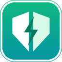

<p align="center">
  
</p>

<h1 align="center">SplitWire Browser</h1>

<p align="center">
  <strong>Hiçbir harici dosya veya .exe çalıştırmadan tamamen tarayıcı içinde tek tıkla çalışan modern VPN / Bölünmüş Tünel (Split Tunnel) uzantısı.</strong>
</p>

<p align="center">
  
  
  
</p>

---

[SplitWire-Turkey](https://github.com/cagritaskn/SplitWire-Turkey) projesinden esinlenilerek geliştirilen **SplitWire Browser**, antivirüs ve SmartScreen uyarılarına sebep olan sürücü (`WinDivert`) ve imzasız `.exe` gereksinimini ortadan kaldırarak kısıt aşımını doğrudan tarayıcıya taşır.

## Öne Çıkan Özellikler

- **%100 Dosyasız Tarayıcı İçi Çalışma:** Ek program veya `.bat` çalıştırmadan yalnızca uzantıyı kurup tek tıkla bağlanın.
- **Düşük Pingli Avrupa Sunucu Keşfi:** Türkiye'ye en yakın Avrupa sunucularını 10'arlı paralel tarama ile test eder, gerçek tek-tur gecikmesini (`ms`) ölçer ve en hızlı sunucuyu yedekli (failover) olarak bağlar.
- **Akıllı Bölünmüş Tünel (Split Tunnel):** Varsayılan olarak yalnızca **Discord, Roblox, Wattpad** ve sizin eklediğiniz siteler tünellenir; diğer tüm internet trafiğiniz (YouTube, oyunlar, bankalar) kendi hızınızda doğrudan bağlanır.
- **Tüm Tarayıcı Modu + Dışlama Listesi:** Tüm sekmeleri tünellerken e-Devlet ve Türk bankacılık sitelerini (`turkiye.gov.tr`, Ziraat, Garanti, İş Bankası vb.) otomatik olarak doğrudan (`DIRECT`) geçirir.
- **Uçtan Uca HTTPS Güvenliği:** Dosyasız ücretsiz sunucu modunda yalnızca şifreli `https://` ve `wss://` bağlantıları tünellenir; düz metin `http://` trafiği üçüncü parti sunuculardan geçirilmez.
- **Chrome & Firefox Tam Uyum:** Chromium tarayıcılarda yerleşik `PAC` motoru, Firefox tabanlı tarayıcılarda ise yerel `browser.proxy.onRequest` (`proxyDNS: true`) API'si kullanılır.
- **Modern ve Sade Arayüz:** Koyu/Açık tema, Türkçe/İngilizce dil desteği, tek tıkla **"Bu Sekmeyi Ekle"** özelliği ve **WebRTC IP sızıntı koruması**.
- **İsteğe Bağlı Yerel Sürücüsüz DPI Motoru:** Sıfır ekstra ping isteyenler için `WinDivert` gerektirmeyen, saf Node.js tabanlı TLS Record Splitting + DoH motoru (`engine/`) ve ByeDPI / Cloudflare WARP / Özel Proxy desteği.

---

## Kurulum

### Chrome / Edge / Brave / Opera / Opera GX / Vivaldi
1. Bu depoyu indirin (**Code → Download ZIP** ve klasöre ayıklayın) veya klonlayın:
   ```bash
   git clone https://github.com/FOXYorj/SplitWire-Browser.git
   ```
2. Tarayıcı adres çubuğuna **`chrome://extensions`** yazıp açın.
3. Sağ üstten **Geliştirici modu (Developer mode)** anahtarını açın.
4. **Paketi açılmış öğe yükle (Load unpacked)** butonuna tıklayıp **`extension`** klasörünü seçin.
5. Uzantıyı araç çubuğuna sabitleyip ortadaki güç butonuna tıklayın.

### Firefox / Zen Browser / Floorp / LibreWolf / Waterfox
1. Tarayıcı adres çubuğuna **`about:debugging#/runtime/this-firefox`** yazıp açın.
2. **Geçici Eklenti Yükle... (Load Temporary Add-on...)** butonuna tıklayın.
3. **`extension-firefox`** klasörünün içindeki **`manifest.json`** dosyasını seçin.
4. Araç çubuğundan **SplitWire Browser** simgesine tıklayıp ortadaki güç butonuna basın.

> **Kalıcı Firefox Kurulumu İpucu:** Standart Firefox'ta `about:debugging` üzerinden yüklenen imzasız eklentiler tarayıcı kapatılınca sıfırlanır. Kalıcı kullanım için **Firefox Developer Edition / Nightly / Zen Browser / LibreWolf / Waterfox** üzerinde `about:config` → `xpinstall.signatures.required = false` ayarını kullanabilirsiniz.

---

## İsteğe Bağlı: Yerel Sürücüsüz DPI Motoru (0 ms Ekstra Ping)

Ücretsiz sunucular yerine doğrudan kendi internet hattınızın hızıyla DPI aşımı yapmak isterseniz (Node.js gerekir, `npm install` veya yönetici izni gerekmez):
1. `Start-SplitWire-Engine.bat` (veya penceresiz arka plan için `Start-SplitWire-Background.vbs`) dosyasına çift tıklayın.
2. Uzantı içinden **Ayarlar → SplitWire DPI (Yerel)** seçeneğini seçin.
3. İSS ön ayarınızı (`Otomatik`, `Türk Telekom / TTNET`, `Superonline`, `Vodafone / Kablonet`) ve DoH sağlayıcınızı seçip bağlanın.

---

## Proje Yapısı

```text
SplitWire-Browser/
├── extension/                     # Chrome, Edge, Brave, Opera, Vivaldi (Manifest V3)
├── extension-firefox/             # Firefox, Zen, Floorp, LibreWolf (proxy.onRequest)
├── engine/                        # İsteğe bağlı sürücüsüz Node.js DPI + DoH motoru
├── scripts/build-firefox.js       # extension/ -> extension-firefox/ senkronizasyon aracı
├── Start-SplitWire-Engine.bat     # Yerel DPI motoru başlatıcı
├── Start-SplitWire-Background.vbs # Arka planda sessiz başlatıcı
└── Stop-SplitWire-Engine.bat      # Yerel DPI motoru durdurucu
```

`extension/` üzerinde değişiklik yaptıktan sonra Firefox sürümünü güncellemek için:
```bash
node scripts/build-firefox.js
```

---

## Atıf ve Lisans

- Bu proje, Çağrı Taşkın'ın açık kaynaklı **[SplitWire-Turkey](https://github.com/cagritaskn/SplitWire-Turkey)** projesinden esinlenilerek sıfırdan tarayıcı uzantısı olarak geliştirilmiştir.
- **MIT Lisansı** altında lisanslanmıştır. Detaylar için [LICENSE](LICENSE) dosyasına bakın.
- Eğitim ve kişisel kullanım amaçlıdır; yasal düzenlemelere uygun kullanım kullanıcının sorumluluğundadır.
